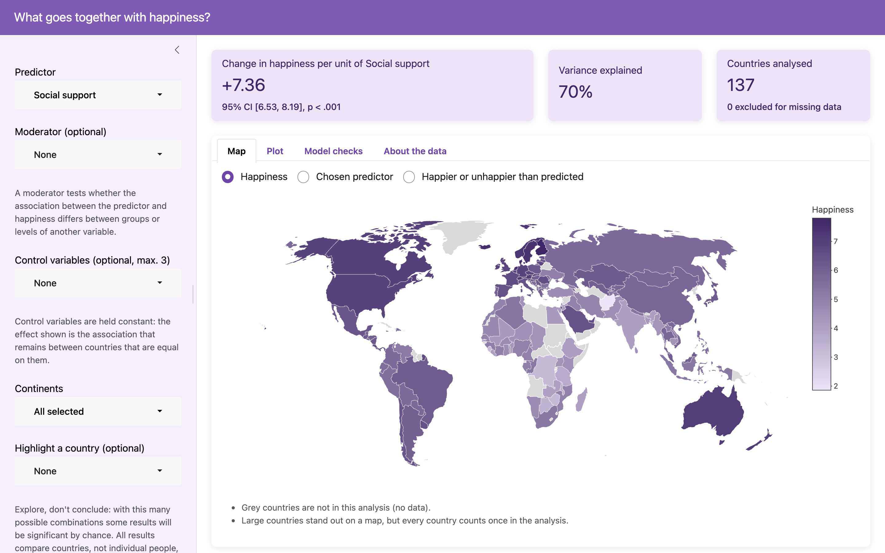
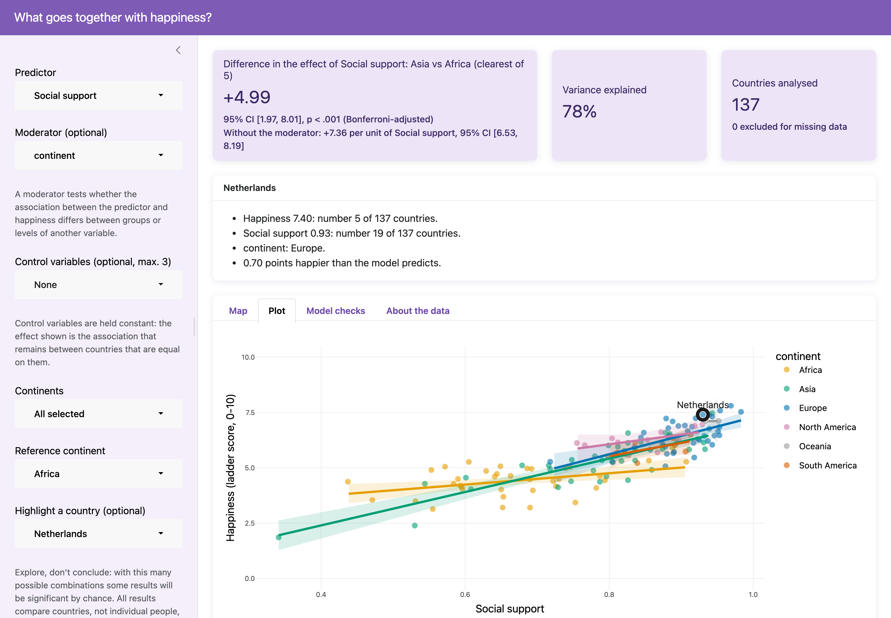

# PiPS Happiness

## 1. Student Info
### A Project by:
Diemithry Kloppenburg, Tian Lin & Christian Kiangala
## 2. Citation
Kloppenburg, D., Lin, T., & Kiangala, C. B. (2026). PiPS-Happiness [Computer software]. GitHub. https://github.com/chriskiangala-rgb/PiPS-Happiness
## 3. App Goal

Why are people happier in some countries than in others? Many country characteristics go together with happiness, such as wealth, health, social support and freedom. These characteristics also go together with each other. The app lets you explore these associations yourself, without writing code.

**Who it's for:** students and researchers in psychology who want to explore which country characteristics go together with happiness, and get ideas for a research question. It is also a teaching tool: you can see what a regression, a moderator or a control variable does to a result.

**What you can do:**
- **Choose a predictor** from 37 variables: those of the World Happiness Report 2023 and the Global Country Information Dataset 2023, plus each country's continent. Then see how strongly it goes together with happiness.
- **Add a moderator** to test whether the association differs between groups, for example between continents.
- **Add up to 3 control variables** to see whether the association remains between countries that are equal on them.
- **Select continents** to compare, and choose the reference continent.
- **Highlight a country** to see where it stands and how much happier or unhappier it is than the model predicts.

**How the results are shown:** a world map, an interactive plot (hover a point to see the country), model checks (residuals, influential countries and overlap between variables), and a summary in plain language next to the coefficient table.

**What it is not:** a way to draw conclusions. Every analysis compares countries, not individual people, and shows associations, not causes. With this many possible combinations, some results will be significant by chance. The app says this in its sidebar, and the model checks show when a model's assumptions are doubtful. Use the app to find patterns worth testing, not to confirm them.
## 4. App Preview

The app opens on a world map of happiness. The tiles at the top show the effect of the chosen predictor, the variance explained and the number of countries analysed.



With a moderator, the Plot tab shows a separate line per group. Here the effect of social support differs per continent, and the Netherlands is highlighted with its own profile above the plot.


## 5. How to use it
>[!IMPORTANT]
>Run everything with this repository root as working directory.
## 6. Repository Structure

```
main.Rmd                        Main deliverable: run its app chunk to start the app
install.R                       Installs the required packages (run once)
references.bib                  References for main.Rmd (data, methods, R and packages)
R/load_project.R                load_project(): loads the data and the high-level functions; the helpers stay out of the global environment
R/prepare_data.R                Loads, merges and cleans the data; creates combined_data and available_predictors
R/analysis/analyse_happiness.R  analyse_happiness(): regression of happiness on a predictor, with optional moderator, control variables, continent selection and a curve
R/analysis/plot_happiness.R     plot_happiness(): plot of the data with the fitted model
R/analysis/report_happiness.R   Readable coefficient table, plain-language summary, curve check and country profile of a result
R/analysis/check_assumptions.R  check_assumptions(): the assumption checks behind the Methods section, and Moran's I
R/app/happiness_app.R           happiness_app(): the Shiny app
R/app/map_happiness.R           World map of happiness, the predictor or the residuals, with Moran's I
R/app/check_model.R             Model checks: residual plots, influential countries and VIF
R/app/predictor_groups.R Groups the predictors by theme for the app's menus
examples/examples.R             Example analyses with explanation: source("examples/examples.R")
tests/error_checks.R            Checks that the data and analysis work: source("tests/error_checks.R")
tests/app_checks.R              Checks that the app and its outputs work: source("tests/app_checks.R")
data/WHR2023.csv                World Happiness Report 2023
data/world-data-2023.csv Global country information 2023
images/                         Screenshots of the app for this README
```


## 7. Dependencies

Run `source("install.R")` once; it installs any required package you do not have yet. The list of packages lives in `install.R`; add new packages there.

The app uses `shiny`, `bslib`, `shinyWidgets`, `plotly`, `ggplot2` and `reactable`. The analysis uses `sandwich` and `lmtest` for the HC3 robust standard errors and the robust Wald tests (Long & Ervin, 2000), and `splines` (part of R) for the curve option. `rmarkdown` knits `main.Rmd`.

## 8. Methods

We regress each country’s happiness—the **World Happiness Report 2023 ladder score**—on one predictor at a time, optionally including a moderator and control variables. The number of countries included depends on the variables selected and the available data.

- **Data transformations:** Country totals are converted to per-person values and skewed variables are log2-transformed. This helps distinguish relative differences between countries from differences in country size. For a log2-transformed predictor, the app reports the effect per 10 times more (for example, a country with 10 times the GDP per person).
- **Statistical inference:** All inference uses HC3 heteroskedasticity-consistent standard errors (Long & Ervin, 2000). Moderation is assessed using a joint Wald test with the same covariance matrix.
- **Small groups:** Categories of a predictor or moderator containing fewer than five countries are excluded from that analysis because estimates for these groups may be unreliable.
- **Nonlinear relationships:** For every numeric predictor, we test whether adding squared and cubed terms improves the fit compared with a straight-line relationship (HC3 Wald test). The app warns that a straight line is misleading when the curve fits significantly better **and** either the line explains less than 80% of the variance the curve explains, or the curve goes in the opposite direction over more than 10% of the predictor's range (5th to 95th percentile). Instead of a line, the predictor can also be fitted as a curve: a natural spline with 3 degrees of freedom, tested against the line with the same HC3 Wald test.

### 1. Assumption checks

We checked the regression assumptions for **35 predictors**, each in the simple model happiness ~ predictor, with the same model as the app (HC3, groups below 5 countries left out). The numbers below come from `check_assumptions()` in `R/analysis/check_assumptions.R`, which `main.Rmd` runs.

- **Unequal residual variance:** The Breusch–Pagan test flagged unequal residual variance for 4 predictors. HC3 robust standard errors were at least 20% larger than conventional standard errors for 5 predictors, reaching 6.1 times the conventional estimate for CPI change (%), for which the Breusch–Pagan test was not significant (*p* = .57). We therefore use HC3 by default rather than selecting it based on a preliminary test. HC3 changed the statistical significance conclusion for 2 of 35 predictors (longitude and log2(CPI)).
- **Residual normality:** Residuals deviated from normality (Shapiro–Wilk) for 22 predictors. Models included 113 to 137 countries. Larger samples can reduce concerns about non-normality, although outliers and influential observations may still affect inference. Every predictor has some countries above the lenient Cook's distance threshold of 4/*n*; 2 predictors (CPI change (%) and log2(CPI)) have an extreme country (Cook's distance above 1).
- **Linearity:** A straight line was a reasonable summary for 27 of 34 numeric predictors. For 7 predictors, the relationship was clearly curved or non-monotonic, so a linear slope alone did not adequately describe it. For example, for labour force participation (%), a linear model explained 0% of the variation in happiness, compared with 21% for a model including squared and cubed terms. The curve the app fits (a natural spline with 3 degrees of freedom) explains 23%; the two numbers differ because the warning and the curve option use different curves, but both show the same inverted U.
- **Spatial dependence:** We computed Moran's I on the residuals, with weights by inverse great-circle distance between country centres (row-standardised). This is a check, not a correction. For social support, residuals from nearby countries were similar (Moran’s *I* = 0.076, *p* < .001). After controlling for continent, Moran’s *I* decreased to 0.044 (*p* < .001), indicating smaller but still significant spatial dependence. For other predictors continent took away most of it: logged GDP per capita 0.085 → 0.007 (*p* = .14), freedom to make life choices 0.161 → 0.017 (*p* = .032). HC3 standard errors do not account for this dependence. The app's map tab shows Moran's I for the residuals of the current model.
- **Continent-clustered inference:** With standard errors clustered by continent and t-tests using five degrees of freedom, the association between social support and happiness remained statistically significant (*p* = .018). Because there are few continent clusters, this result should be interpreted cautiously.

### 2. Limitations

- **Countries, not individuals:** Results describe differences between countries. They cannot establish why individual people are happier; drawing individual-level conclusions from country-level associations risks the ecological fallacy.
- **Associations, not causes:** The data are cross-sectional and do not establish causality. For example, social support may contribute to happiness, but happier countries may also develop stronger social support.
- **Omitted variables:** Culture, history, institutions and other unmeasured factors may explain both a predictor and happiness.
- **Countries are not independent:** Nearby countries have similar residuals, as indicated by Moran’s I. Controlling for continent reduces this dependence, but any remaining dependence may affect standard errors and p-values. HC3 does not account for spatial dependence; spatial regression is a possible next step.
- **Nonlinear relationships:** For 7 of 34 numeric predictors, the relationship is clearly curved or non-monotonic. Their linear slopes alone do not adequately describe the relationship; the app warns about this and offers a curve instead.
- **Measurement and missing data:** The country-level variables come from a Kaggle dataset combining several sources and years, without source information for each variable. Some variables have substantial missing data. For example, minimum-wage data are available for 113 of 137 countries. Missing data may affect which countries are represented and introduce selection bias.
- **Exploratory analysis:** Testing many predictors and combinations increases the chance of statistically significant findings occurring by chance. Results should be treated as hypotheses for further testing rather than definitive conclusions.
  
## 9. Student Roles
- Diemithry was primarily responsible for the app: the Shiny app that lets users explore the data and run the analysis interactively. Diemithry also contributed to the analysis code and its checks, and reviewed pull requests of the other group members.
- Tian was responsible for the code and data surrounding the analysis. Tian collected the data that would be used in this project and wrote the basis of the analysis that would be used for the app. He also wrote a part of the README and reviewed some code of his other group members.
- Christian was the project leader and was responsible for the README and the repository structure. He also created an error check file and reviewed code.

## 10. AI statement
- Diemithry used Claude (Claude Code) to help write, test and review the code of the app and the analysis, to run the assumption checks, and to draft README text and pull request descriptions. Every change was checked and tested before it was committed.
- Tian used LLMs (UvA AI Chat and Claude) to help write code for the analysis and parts of the README, and review code from both himself and his teammates.
- Christian used LLMs (UvA AI Chat and Claude) to help write and review code and to get feedback on the repository and README structure.

## 11. References
* Elgiriyewithana, N. (2023). Global Country Information Dataset 2023. https://www.kaggle.com/. Retrieved October 22, 2026, from https://www.kaggle.com/datasets/nelgiriyewithana/countries-of-the-world-2023  
* Long, J. S., & Ervin, L. H. (2000). Using heteroscedasticity consistent standard errors in the linear regression model. The American Statistician, 54(3), 217. https://doi.org/10.1080/00031305.2000.10474549  
* Singh, A. (2023). World Happiness Report 2023. Retrieved October 16, 2026, from https://www.kaggle.com/datasets/ajaypalsinghlo/world-happiness-report-2023
